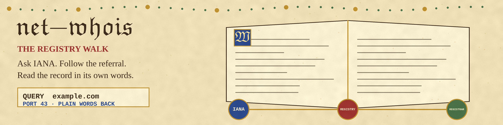

# net-whois

I ask the WHOIS registries about a domain or an IP address and
bring back what they say, in their own words.

WHOIS is an old, plain protocol: open a TCP connection to port 43,
send the query, read until the server hangs up. No library earns
its keep doing that, so this tool is standard library sockets and
nothing else.

## How I pick a server

Choosing who to ask is the only real judgment in the tool.

- For common TLDs (com, net, org, info, io, uk, de, edu) I go
  straight to the registry that runs them.
- For anything else, and for IP addresses, I start at IANA
  (whois.iana.org) and follow its referral, the way the system was
  designed to be walked.
- Thin registries answer with a pointer to the registrar's own
  WHOIS server. I follow that too, up to three servers total,
  unless you pass `--no-referral`.

The chain of servers I actually asked is printed on stderr, so
stdout stays the record itself, unedited.

## Install

```bash
git clone https://github.com/ShadowGuard-AI/net-whois.git
cd net-whois
```

Python 3, standard library only. There is nothing to install. (The
old requirements.txt listed socket and logging as if they were
downloads; it is gone.)

## Usage

```bash
python3 main.py example.com
```

```bash
python3 main.py 192.0.2.1 --json
```

```bash
python3 main.py example.org --server whois.pir.org --no-referral
```

## Parameters

- `query`: the domain name or IPv4 address to look up.
- `--server`: ask this WHOIS server first, instead of the one I
  would pick. This is also how a loopback test points the tool at a
  fake server.
- `--port`: the port the servers listen on. Default 43. Referral
  hops use the same port.
- `--no-referral`: take the first answer as final.
- `--timeout`: seconds per connection. Default 10.
- `--json`: emit the answer as JSON with the server chain
  included, instead of the raw record.

## Verified in this wave

No test suite ships in this repo, so the old Testing section
claiming one has been replaced with what was actually run here:
against a fake WHOIS server on loopback, a raw lookup returned
the record with exit 0 and "servers asked: 127.0.0.1" on stderr,
the `--json` form returned the query, server chain, and response,
and a refused connection printed an error and exited 2. No live
registry was contacted in this wave. Thin answers, registrar
referrals, and empty responses are not claimed as tested here,
because no suite for them is in the repo.

## Exit codes

- `0`: an answer came back and was delivered.
- `2`: the lookup failed (connection error) or the registry
  answered with an empty response. Nothing retrieved is never
  reported as success.

## License

MIT. See [LICENSE](LICENSE).
Copyright (c) Gavin K (@Epsilon0xCell).
